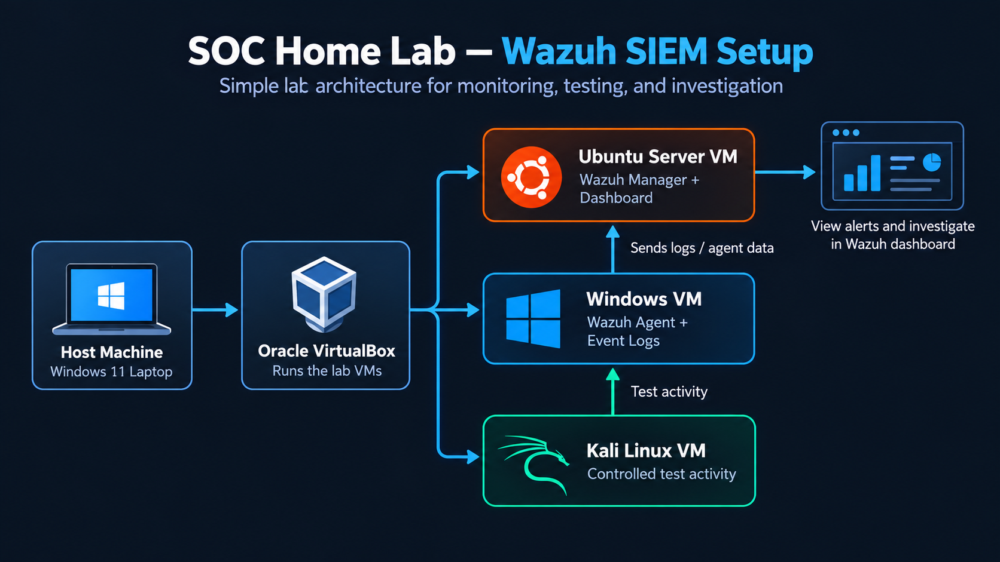

# SOC Home Lab - Wazuh SIEM

A hands-on cybersecurity / SOC home lab built to practise SIEM monitoring, log analysis, threat detection, and basic incident investigation using Wazuh.

The project is being developed step by step, with configurations, practical exercises, and findings documented along the way.

## Lab Architecture

### Environment

| Component               | Purpose                               |
| ----------------------- | ------------------------------------- |
| Oracle VirtualBox       | Virtualization platform               |
| Ubuntu Server 24.04 LTS | Wazuh Manager, Indexer, and Dashboard |
| Windows VM              | Wazuh Agent and event log monitoring  |
| Kali Linux              | Controlled security testing           |

## Project Progress

- [x] Install and configure Ubuntu Server
- [x] Install Wazuh SIEM
- [x] Configure networking and SSH
- [x] Verify Wazuh Dashboard and API
- [x] Deploy and connect Windows Agent
- [ ] Monitor Windows security events
- [ ] Test detection and investigate alerts
- [ ] Document investigation findings

## Documentation

- [Ubuntu Server Setup](docs/ubuntu-server-setup.md)
- [Wazuh Server Setup](docs/wazuh-server-setup.md)
- [Windows VM and Wazuh Agent Setup](docs/windows-agent-setup.md)

Additional documentation will be added as the lab progresses.

## References

- [Wazuh Documentation](https://documentation.wazuh.com/current/)
- [Wazuh Home Lab Tutorial - The Social Dork](https://www.youtube.com/watch?v=QT81wcuoRFY)
