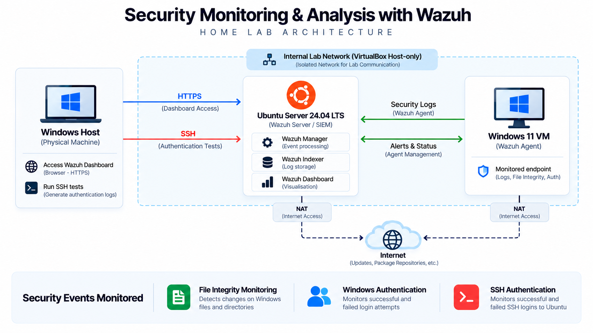

# Security Monitoring & Analysis with Wazuh

A home lab using [Wazuh](https://wazuh.com/) SIEM to collect, monitor and analyse security events from Windows and Ubuntu systems. The project includes file integrity monitoring, authentication monitoring and controlled detection tests.

## Lab Architecture

The environment uses a VirtualBox Host-only network for communication between the systems, with NAT adapters for internet access.

| Component               | Purpose                                              |
| ----------------------- | ---------------------------------------------------- |
| Oracle VirtualBox       | Virtualization and lab networking                    |
| Ubuntu Server 24.04 LTS | Wazuh Manager, Indexer, Dashboard and SSH monitoring |
| Windows 11 Pro          | Monitored endpoint running the Wazuh Agent           |
| Windows host            | Accessing Wazuh and testing SSH authentication       |

## Detection Tests

Three controlled scenarios were tested and analysed using Wazuh.

| Test                      | Activity                                                             | Result                            |
| ------------------------- | -------------------------------------------------------------------- | --------------------------------- |
| File Integrity Monitoring | Created, modified and deleted files in a monitored Windows directory | All changes detected in real time |
| Windows Authentication    | Generated failed and successful interactive logins                   | Both event types detected         |
| SSH Authentication        | Generated failed and successful SSH logins on Ubuntu                 | Both event types detected         |

The alerts were reviewed using their event details, detection rules and supporting logs. All tests were performed in a controlled environment and did not involve real security incidents.

Detailed test results, analysis and screenshots are available in [Detection and Analysis](docs/detection-and-analysis.md).

## Documentation

### Monitoring and Analysis

- [Detection and Analysis](docs/detection-and-analysis.md)
- [Final Report](docs/final-report.md)

### Environment Setup

- [Ubuntu Server Setup](docs/ubuntu-server-setup.md)
- [Wazuh Server Setup](docs/wazuh-server-setup.md)
- [Windows VM and Wazuh Agent Setup](docs/windows-agent-setup.md)

## References

- [Wazuh Documentation](https://documentation.wazuh.com/current/)
- [Wazuh Home Lab Tutorial - The Social Dork](https://www.youtube.com/watch?v=QT81wcuoRFY)
