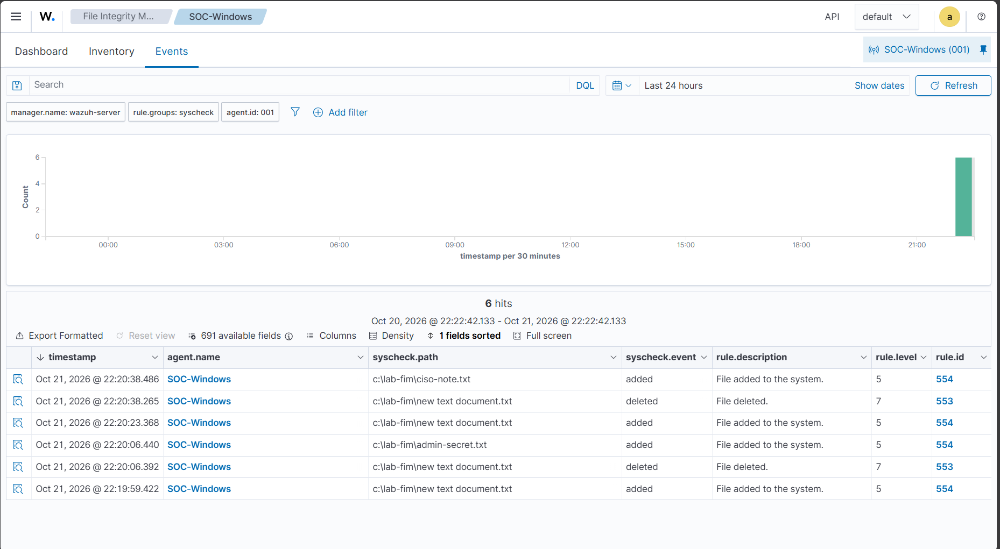
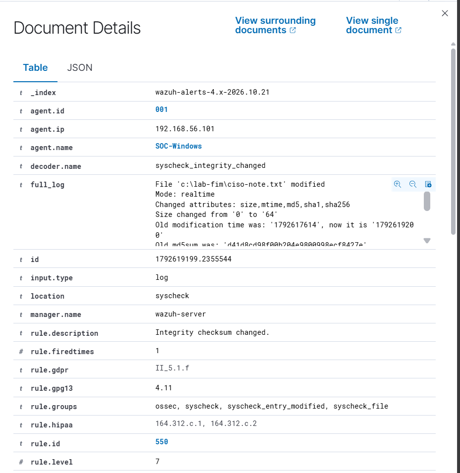
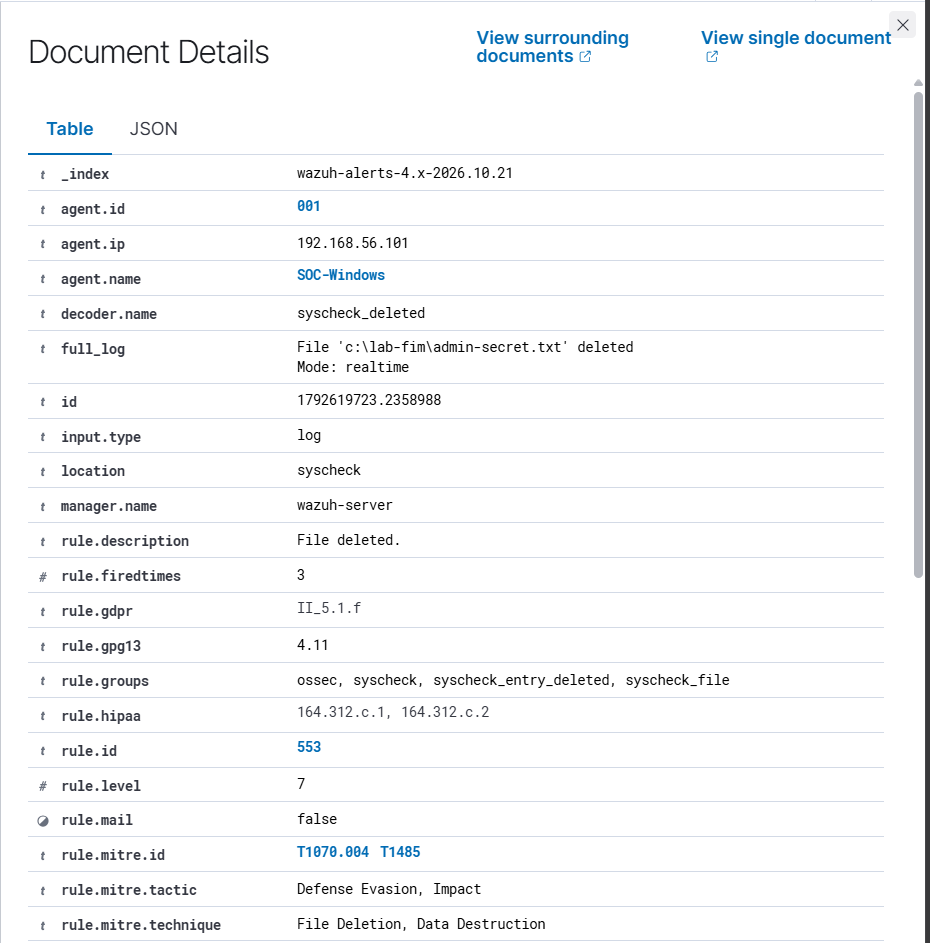
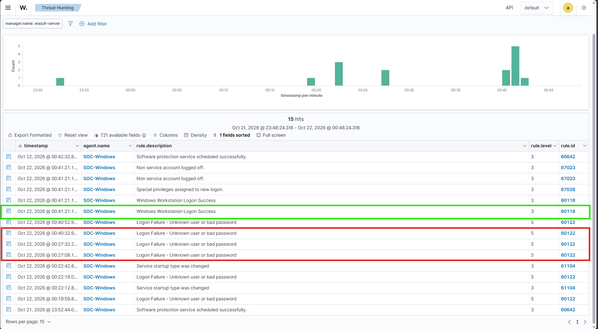
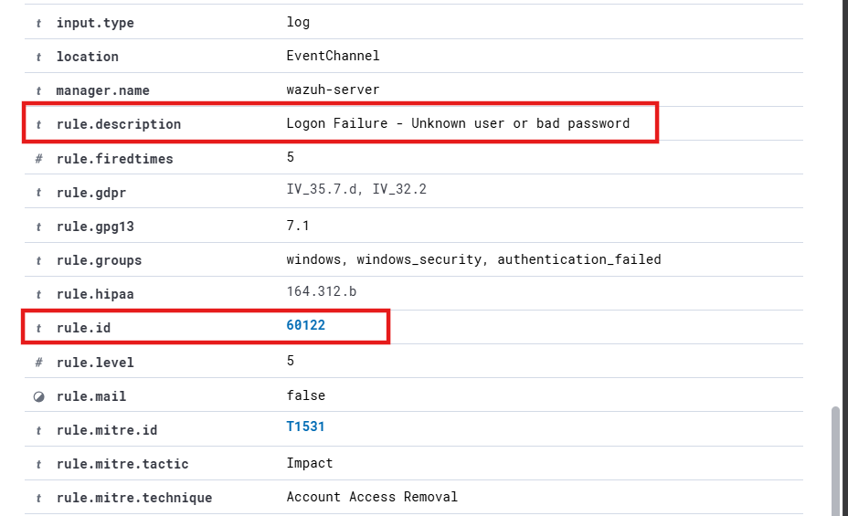
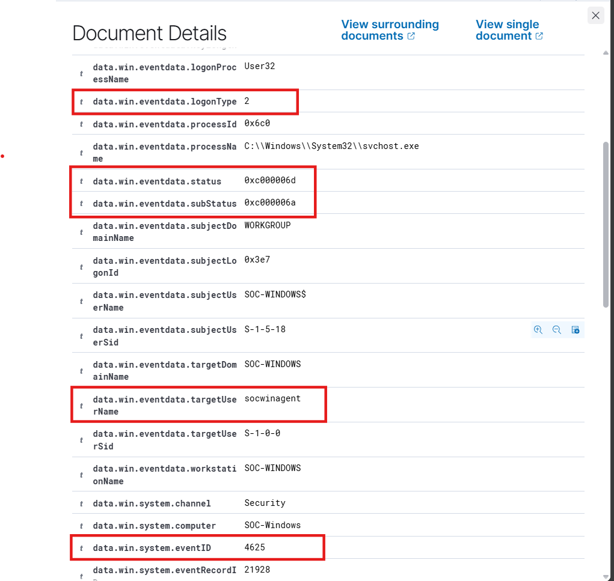
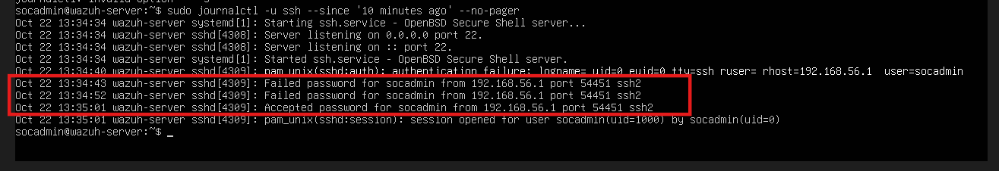
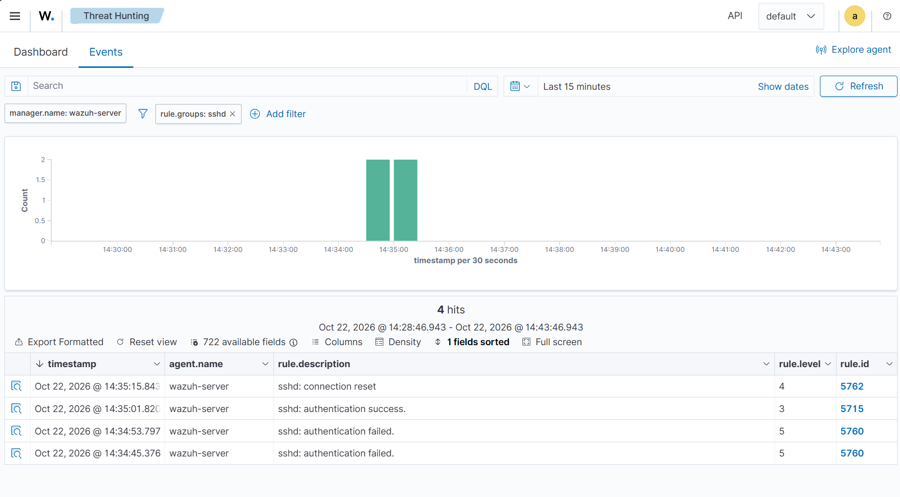

# Security Monitoring - Detection and Analysis

This document records the controlled security tests performed in my [Wazuh](https://wazuh.com/) home lab, including detection results, event analysis, and supporting evidence.

## 1. [File Integrity Monitoring (FIM)](https://www.crowdstrike.com/en-us/cybersecurity-101/exposure-management/file-integrity-monitoring/)

**Objective:** Check whether Wazuh detects file creation, modification and deletion on a Windows endpoint.

**Endpoint:** `SOC-Windows` (agent `001`)  
**Monitored directory:** `C:\Lab-FIM`

Opened the Windows Agent configuration file in PowerShell (Administrator):

```powershell
notepad "C:\Program Files (x86)\ossec-agent\ossec.conf"
```

Added the following entry inside the existing `<syscheck>` section to enable real-time monitoring of our test directory:

```xml
<directories realtime="yes">C:\Lab-FIM</directories>
```

Saved the configuration and restarted the Wazuh Agent using PowerShell (Administrator):

```powershell
Restart-Service -Name WazuhSvc
```

### Test results

| Action | Test performed                                 | Rule ID | Level | Result   |
| ------ | ---------------------------------------------- | ------- | ----- | -------- |
| Create | Created `admin-secret.txt` and `ciso-note.txt` | `554`   | 5     | Detected |
| Modify | Added text to `ciso-note.txt` and saved it     | `550`   | 7     | Detected |
| Delete | Deleted `admin-secret.txt`                     | `553`   | 7     | Detected |

### Observations and analysis

**File creation:** Creating a text document in Windows File Explorer triggered an `added` event for `New Text Document.txt`, followed by a `deleted` event for the original path and another `added` event for the chosen filename. This occurred even when the file was named immediately during creation. The events reflect the filename change rather than an actual destructive action.



**File modification:** The event for `ciso-note.txt` recorded a size change from 0 to 64 bytes, an updated modification time and different MD5, SHA-1 and SHA-256 hashes. The checksum changes confirm that the file contents changed.



**File deletion:** The alert for `admin-secret.txt` included MITRE ATT&CK mappings `T1070.004` (File Deletion) and `T1485` (Data Destruction). Those mappings identify potentially relevant techniques; they do not mean this controlled deletion was malicious.



**Result:** Wazuh detected all three file operations in real time. The alerts recorded the changes but did not establish who performed them or why.

## 2. [Windows Authentication Monitoring](https://learn.microsoft.com/en-us/windows-server/identity/ad-ds/plan/Appendix-L--Events-to-Monitor)

**Objective:** Verify that Wazuh detects successful and failed Windows login attempts.

**Endpoint:** `SOC-Windows` (agent `001`)

The Windows agent was already configured to collect Security events through the `eventchannel` log format in `ossec.conf`. No additional configuration was required.

### Test Activity

1. Locked the Windows VM using `Win + L`.
2. Entered an incorrect password several times for the `socwinagent` account.
3. Signed in using the correct password.
4. Verified the failed login in Windows Event Viewer under **Windows Logs → Security** (Event ID `4625`).
5. Checked **Wazuh Threat Hunting → Events** for the corresponding authentication alerts.

### Detection Results

| Activity         | Windows Event ID | Wazuh Rule ID | Level | Result   |
| ---------------- | ---------------- | ------------- | ----- | -------- |
| Failed login     | `4625`           | `60122`       | 5     | Detected |
| Successful login | `4624`           | `60118`       | 3     | Detected |



### Observations and Analysis

**Failed login:** Wazuh recorded the unsuccessful authentication attempt under Rule `60122`, with the description `Logon Failure - Unknown user or bad password`.



The failed event details showed:

| Field            | Observed value | Interpretation                    |
| ---------------- | -------------- | --------------------------------- |
| Windows Event ID | `4625`         | Failed Windows logon              |
| Target account   | `socwinagent`  | Account used in the login attempt |
| Logon type       | `2`            | Interactive Windows login         |
| Status           | `0xC000006D`   | Authentication failure            |
| Substatus        | `0xC000006A`   | Incorrect password                |

These values matched our controlled failed-password test.



**Successful login:** After entering the correct password, Wazuh recorded a successful workstation login under Rule `60118` (Level 3).

Multiple failed-login events were visible in the dashboard, but these were generated during our own testing and do not establish a brute-force attack.

**Result:** Wazuh successfully detected both failed and successful interactive Windows logins, including the relevant Windows Event IDs and Wazuh detection rules.

## 3. [SSH Authentication Monitoring](https://documentation.wazuh.com/current/proof-of-concept-guide/detect-brute-force-attack.html)

**Objective:** Verify that Wazuh detects failed and successful SSH authentication attempts on Ubuntu.

**Target:** `wazuh-server` (agent `000`, `192.168.56.10`)  
**Source:** Windows host (`192.168.56.1`)  
**Account:** `socadmin`

The Wazuh Manager was already configured to collect Ubuntu system logs through `journald` in `/var/ossec/etc/ossec.conf`. No additional configuration was required.

### Test Activity

1. Opened PowerShell on the Windows host and connected to Ubuntu using SSH:

   ```powershell
   ssh socadmin@192.168.56.10
   ```

2. Entered an incorrect password twice, followed by the correct password.
3. Checked the SSH authentication logs on Ubuntu:

   ```bash
   sudo journalctl -u ssh --since "10 minutes ago" --no-pager
   ```



4. Verified the corresponding alerts in **Wazuh Threat Hunting → Events**, filtered by `rule.groups: sshd`.

### Detection Results

| Activity                      | Wazuh Rule ID | Level | Result   |
| ----------------------------- | ------------- | ----- | -------- |
| Failed SSH login (2 attempts) | `5760`        | 5     | Detected |
| Successful SSH login          | `5715`        | 3     | Detected |



### Observations and Analysis

**Failed authentication:** Ubuntu recorded two incorrect password attempts for `socadmin` from `192.168.56.1`. Wazuh detected both under Rule `5760`, identifying the target account, source IP and authentication failure.

**Successful authentication:** The correct password was accepted shortly afterward, generating Rule `5715`. Both failed and successful events shared the same source IP (`192.168.56.1`) and source port (`54451`), linking them to the same SSH connection.

| Field          | Observed value |
| -------------- | -------------- |
| Target account | `socadmin`     |
| Source IP      | `192.168.56.1` |
| Source port    | `54451`        |
| Log source     | `journald`     |
| Decoder        | `sshd`         |

Wazuh mapped the failed authentication to MITRE ATT&CK techniques `T1110.001` (Password Guessing) and `T1021.004` (SSH). These mappings provide security context but do not establish malicious activity.

In a real investigation, failed login attempts followed by successful authentication from the same source could warrant further review. In this case, all attempts were intentionally generated as part of the lab.

**Result:** Wazuh successfully detected failed and successful SSH authentication on Ubuntu using its existing local log collection configuration.
