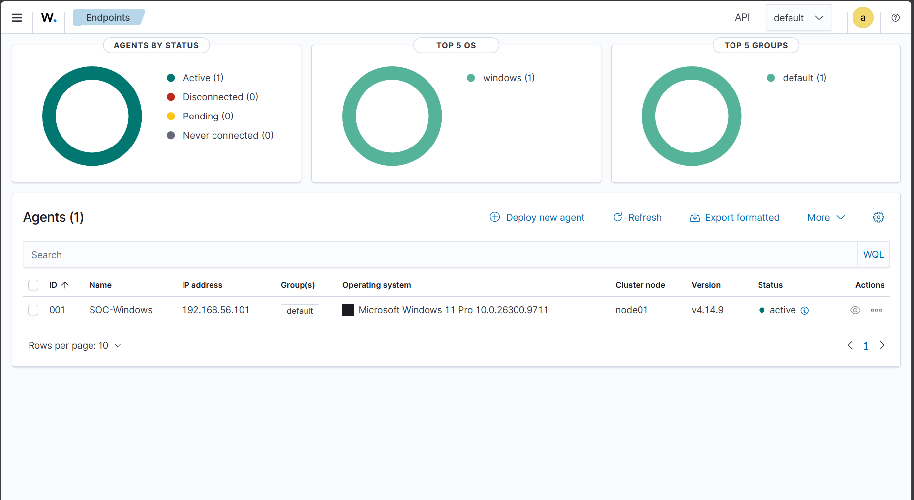

# Windows VM and Wazuh Agent Setup

This guide covers how I installed Windows 11 Pro in VirtualBox, configured its network, and connected it to my Wazuh home lab using the Windows agent.

## 1. Create the Windows VM

Download the Windows 11 **x64 ISO** from [Microsoft](https://www.microsoft.com/software-download/windows11).

In VirtualBox, create a new VM using these settings:

| Setting                 | Configuration                      |
| ----------------------- | ---------------------------------- |
| Name                    | `SOC-Windows`                      |
| OS                      | Windows 11 Pro (64-bit)            |
| RAM                     | 8 GB                               |
| CPUs                    | 4                                  |
| Disk                    | 65 GB, VDI (dynamically allocated) |
| Unattended installation | Disabled (manual installation)     |
| UEFI / Secure Boot      | Enabled                            |
| TPM                     | 2.0                                |
| Network Adapter 1       | NAT                                |

Start the VM and follow the Windows installation process. Select **Windows 11 Pro** and install it on the 65 GB virtual disk.

After installation, complete the initial Windows setup and install the available security updates.

I also installed VirtualBox Guest Additions for better display and mouse integration.

## 2. Add the Host-only network

Shut down the Windows VM.

In **VirtualBox → SOC-Windows → Settings → Network**:

- **Adapter 1:** Keep `NAT` for internet access.
- **Adapter 2:** Enable **Host-only Adapter** and select `VirtualBox Host-Only Ethernet Adapter`.
- **Adapter Type:** Keep the default `Intel PRO/1000 MT Desktop (82540EM)`.
- Ensure **Cable Connected** is checked, then click **OK**.

Start Windows and open **Command Prompt**:

```cmd
ipconfig
```

The Host-only adapter received `192.168.56.101` through DHCP in my lab.

> **Before proceeding ahead:** Make sure the Wazuh Server is running and accessible at `192.168.56.10`. See the [Ubuntu Server Setup](ubuntu-server-setup.md) and [Wazuh Server Setup](wazuh-server-setup.md) guides if you haven't configured it yet.

With the Wazuh Server running, test connectivity:

```cmd
ping 192.168.56.10
```

You should receive replies from the server.

> **Note:** Your Windows IP may differ because DHCP assigns an available address. The Wazuh Server uses the static address `192.168.56.10` in this lab.

## 3. Deploy the Wazuh Agent

Open the Wazuh Dashboard at `https://192.168.56.10` and navigate to **Endpoints → Deploy new agent**.

Choose:

| Setting        | Value           |
| -------------- | --------------- |
| Package        | MSI 32/64 bits  |
| Server address | `192.168.56.10` |
| Agent name     | `SOC-Windows`   |
| Group          | `default`       |

Inside the **Windows VM**, open **Windows PowerShell as Administrator**.

Copy and run the installation command generated by the dashboard. This was the command used in my lab:

```powershell
Invoke-WebRequest -Uri https://packages.wazuh.com/4.x/windows/wazuh-agent-4.14.9-1.msi -OutFile $env:tmp\wazuh-agent; msiexec.exe /i $env:tmp\wazuh-agent /q WAZUH_MANAGER='192.168.56.10' WAZUH_AGENT_NAME='SOC-Windows'
```

Once installation completes, start the agent:

```powershell
NET START Wazuh
```

## 4. Verify the connection

In the Wazuh Dashboard, open **Endpoints** and check that the agent appears as **Active**.

My connection showed:

| Field         | Value            |
| ------------- | ---------------- |
| Agent name    | `SOC-Windows`    |
| Agent ID      | `001`            |
| IP address    | `192.168.56.101` |
| Agent version | `4.14.9`         |
| Status        | Active           |



Open the agent details to confirm Wazuh is receiving endpoint information.

In my lab, **System Inventory** and **Security Configuration Assessment** results appeared after enrollment.

**Result:** The Windows 11 VM is connected to Wazuh and ready for security-event monitoring and detection exercises.
